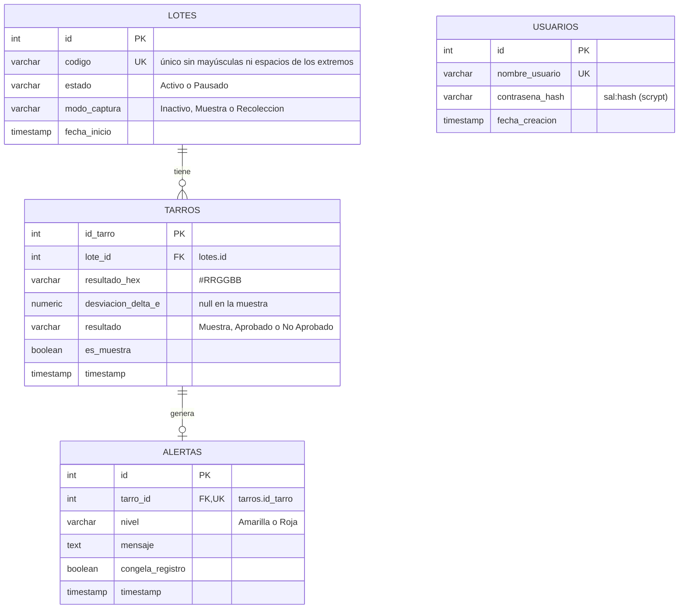

# Modelo de datos · ChromaCheck

Base: PostgreSQL 17 en Neon. Solo el servidor (Next.js) se conecta, con `DATABASE_URL`; el navegador y el puente serial nunca tocan la base directamente, siempre pasan por la API ([contratos/api.md](../contratos/api.md)).

Este documento es la fuente de verdad de las tablas. Antes de crear una tabla, una columna o una consulta nueva, se revisa aquí; si algo cambia, se actualiza este archivo en el mismo PR. El esquema se crea y se cambia con las migraciones de [`db/migraciones/`](../../db/migraciones/README.md).

## Diagrama entidad-relación



- Un lote tiene muchos tarros; uno de ellos es la muestra patrón (`es_muestra = true`) y los demás son lecturas.
- Cada lectura genera como máximo una alerta.
- `usuarios` no se relaciona con las demás tablas: hay una sola cuenta del taller y sin roles, así que no se guarda quién creó cada lote o tarro (ver [producto.md](../producto.md)).
- Las franjas de tiempo, los dictámenes posibles y los umbrales de ΔE no son tablas: viven en `lib/modulos/tarros/reglas.ts`.

## Tablas

Los tipos se confirmaron el 2026-11-20 con las consultas del [anexo](#anexo-consultas-para-confirmar-el-esquema), en la rama `desarrollo` de Neon (copia de la principal). [`0001_esquema_inicial.sql`](../../db/migraciones/0001_esquema_inicial.sql) los reproduce.

### `lotes`

| Campo          | Tipo          | ¿Nulo? | Regla                                                                                                                               |
| -------------- | ------------- | ------ | ----------------------------------------------------------------------------------------------------------------------------------- |
| `id`           | `serial`      | No     | Clave primaria                                                                                                                      |
| `codigo`       | `varchar(50)` | No     | De 1 a 50 caracteres sin los espacios de los extremos. Único sin distinguir mayúsculas (índice `lotes_codigo_unico`)                |
| `estado`       | `varchar(20)` | No     | `Activo` por defecto; `Pausado` tras una alerta roja (CHECK `lotes_estado_valido`)                                                  |
| `modo_captura` | `varchar(20)` | No     | `Inactivo` por defecto, `Muestra` o `Recoleccion` (CHECK `lotes_modo_captura_valido`). Solo un lote distinto de `Inactivo` a la vez |
| `fecha_inicio` | `timestamp`   | No     | `now()` por defecto. Fecha de creación del lote (cumple el papel de `created_at`); ordena la lista de lotes                         |

### `tarros`

| Campo                | Tipo          | ¿Nulo? | Regla                                                                                                          |
| -------------------- | ------------- | ------ | -------------------------------------------------------------------------------------------------------------- |
| `id_tarro`           | `serial`      | No     | Clave primaria                                                                                                 |
| `lote_id`            | `integer`     | No     | Clave foránea a `lotes.id` (`tarros_lote_id_fkey`)                                                             |
| `resultado_hex`      | `varchar(7)`  | No     | Color leído con formato `#RRGGBB`, mayúsculas o minúsculas (CHECK `tarros_resultado_hex_formato`)              |
| `desviacion_delta_e` | `numeric`     | Sí     | ΔE (CIE76) frente a la muestra; el código lo redondea a 2 decimales. `null` solo en la muestra                 |
| `resultado`          | `varchar(20)` | No     | `Muestra`, `Aprobado` o `No Aprobado` (CHECK `tarros_resultado_valido`); lo decide el servidor                 |
| `es_muestra`         | `boolean`     | No     | `false` por defecto. `true` solo en el tarro muestra del lote (índice `tarros_una_muestra_por_lote`)           |
| `timestamp`          | `timestamp`   | No     | `now()` por defecto. Fecha y hora de la lectura (cumple el papel de `created_at`); ordena lecturas e historial |

### `alertas`

| Campo              | Tipo          | ¿Nulo? | Regla                                                                                                                        |
| ------------------ | ------------- | ------ | ---------------------------------------------------------------------------------------------------------------------------- |
| `id`               | `serial`      | No     | Clave primaria                                                                                                               |
| `tarro_id`         | `integer`     | No     | Clave foránea a `tarros.id_tarro` (`alertas_tarro_id_fkey`): la lectura que causó la alerta. Única (`alertas_una_por_tarro`) |
| `nivel`            | `varchar(10)` | No     | `Amarilla` o `Roja` (CHECK `alertas_nivel_valido`)                                                                           |
| `mensaje`          | `text`        | No     | Motivo que ve el operario (tabla de mensajes de [F5](../specs/F5-alertas-y-pausa.md))                                        |
| `congela_registro` | `boolean`     | No     | `false` por defecto. `true` si y solo si `nivel = 'Roja'` (CHECK `alertas_congela_coherente`)                                |
| `timestamp`        | `timestamp`   | No     | `now()` por defecto. Fecha y hora de la alerta (cumple el papel de `created_at`)                                             |

### `usuarios`

Definición en [contratos/autenticacion.md](../contratos/autenticacion.md).

| Campo             | Tipo           | ¿Nulo? | Regla                                                   |
| ----------------- | -------------- | ------ | ------------------------------------------------------- |
| `id`              | `serial`       | No     | Clave primaria                                          |
| `nombre_usuario`  | `varchar(50)`  | No     | Único                                                   |
| `contrasena_hash` | `varchar(255)` | No     | `sal:hash` en hexadecimal (scrypt); nunca la contraseña |
| `fecha_creacion`  | `timestamp`    | No     | `now()` por defecto (cumple el papel de `created_at`)   |

## Restricciones

| Nombre                         | Tabla      | Tipo            | Qué garantiza                                                                                                     |
| ------------------------------ | ---------- | --------------- | ----------------------------------------------------------------------------------------------------------------- |
| Clave primaria (`*_pkey`)      | Todas      | PRIMARY KEY     | Cada fila tiene un id único                                                                                       |
| `tarros_lote_id_fkey`          | `tarros`   | FOREIGN KEY     | No hay tarros de un lote que no existe                                                                            |
| `alertas_tarro_id_fkey`        | `alertas`  | FOREIGN KEY     | No hay alertas de un tarro que no existe                                                                          |
| `lotes_codigo_unico`           | `lotes`    | UNIQUE (índice) | No hay dos lotes con el mismo código; compara `LOWER(TRIM(codigo))`                                               |
| `lotes_un_lote_capturando`     | `lotes`    | UNIQUE parcial  | Solo un lote con `modo_captura <> 'Inactivo'`, aunque lleguen dos peticiones a la vez                             |
| `lotes_modo_captura_valido`    | `lotes`    | CHECK           | `modo_captura` solo puede ser `Inactivo`, `Muestra` o `Recoleccion`                                               |
| `lotes_estado_valido`          | `lotes`    | CHECK           | `estado` solo puede ser `Activo` o `Pausado`                                                                      |
| `tarros_una_muestra_por_lote`  | `tarros`   | UNIQUE parcial  | Un solo tarro con `es_muestra` verdadero por lote                                                                 |
| `tarros_resultado_valido`      | `tarros`   | CHECK           | `resultado` solo puede ser `Muestra`, `Aprobado` o `No Aprobado`                                                  |
| `tarros_resultado_hex_formato` | `tarros`   | CHECK           | `resultado_hex` cumple `^#[0-9A-Fa-f]{6}$`, el mismo patrón que `lib/validacion.ts`                               |
| `tarros_muestra_o_lectura`     | `tarros`   | CHECK           | O es muestra (`es_muestra`, `Muestra`, ΔE nulo) o es lectura (no muestra, `Aprobado` o `No Aprobado`, ΔE no nulo) |
| `alertas_una_por_tarro`        | `alertas`  | UNIQUE          | Cada lectura genera como máximo una alerta                                                                        |
| `alertas_nivel_valido`         | `alertas`  | CHECK           | `nivel` solo puede ser `Amarilla` o `Roja`                                                                        |
| `alertas_congela_coherente`    | `alertas`  | CHECK           | `congela_registro = (nivel = 'Roja')`                                                                             |
| `usuarios_nombre_usuario_key`  | `usuarios` | UNIQUE          | No hay dos usuarios con el mismo nombre                                                                           |

### Índices de consulta

No garantizan reglas; aceleran las consultas por lote y por fecha.

| Nombre                 | Tabla    | Columnas      | Para qué                                                                |
| ---------------------- | -------- | ------------- | ----------------------------------------------------------------------- |
| `idx_tarros_lote`      | `tarros` | `lote_id`     | Traer los tarros de un lote (pantalla del lote, ΔE frente a la muestra) |
| `idx_tarros_timestamp` | `tarros` | `"timestamp"` | Ordenar lecturas e historial por fecha                                  |

## Reglas de negocio y en qué capa se garantizan

Regla de oro: si una regla protege la integridad del lote o del dictamen, se garantiza en la base; el servidor la repite para responder con un mensaje claro.

| #   | Regla (lo que nunca puede pasar)                                                          | Capa          | Cómo                                                                                                                                                                               |
| --- | ----------------------------------------------------------------------------------------- | ------------- | ---------------------------------------------------------------------------------------------------------------------------------------------------------------------------------- |
| R1  | Dos lotes con el mismo código                                                             | BD + servidor | Índice `lotes_codigo_unico`; `insertarLote` traduce el error 23505 y la ruta responde 409                                                                                          |
| R2  | Un código vacío o de más de 50 caracteres                                                 | Servidor + BD | `POST /api/lotes` recorta espacios y usa `excedeLongitudCodigoLote` (400); la columna es `varchar(50)`                                                                             |
| R3  | Dos lotes usando el sensor al mismo tiempo                                                | BD + servidor | Índice `lotes_un_lote_capturando`; `cambiarModoCaptura` revisa antes y el repositorio traduce el 23505 a 409 si dos peticiones llegan juntas                                       |
| R4  | Un modo de captura inventado                                                              | BD + servidor | CHECK `lotes_modo_captura_valido`; la ruta usa `esModoCapturaValido` (400)                                                                                                         |
| R5  | Dos muestras patrón en un lote                                                            | BD + servidor | Índice `tarros_una_muestra_por_lote`; `obtenerMotivoRechazoMuestra` (409) y `registrarMuestraDeLote`, que en una transacción saca el lote de `Muestra` con un `UPDATE` condicional |
| R6  | Registrar la muestra fuera del modo `Muestra`, o una lectura fuera del modo `Recoleccion` | Servidor      | `puedeRegistrarMuestra` y `puedeRegistrarLectura` en `lotes/reglas.ts` (409)                                                                                                       |
| R7  | Una lectura en un lote sin muestra o `Pausado`                                            | Servidor      | `obtenerMotivoRechazoLectura` en `tarros/reglas.ts` (409)                                                                                                                          |
| R8  | Un lote pausado que sigue capturando                                                      | BD            | `pausarLoteYDetenerCaptura`: `estado = 'Pausado'` y `modo_captura = 'Inactivo'` en la misma sentencia                                                                              |
| R9  | Reanudar un lote que no está pausado                                                      | Servidor + BD | `obtenerMotivoRechazoReanudar` (409) y el `UPDATE … WHERE estado = 'Pausado'` de `reanudarLotePausado`                                                                             |
| R10 | Un ΔE o un dictamen enviados por el cliente                                               | Servidor      | `POST /api/tarros` no lee ΔE ni resultado: los calculan `calcularDesviacionDeltaE` y `obtenerResultadoLectura`                                                                     |
| R11 | Una lectura cuyo `rgb` no es el mismo color que `resultadoHex`                            | Servidor      | `coincidenColorHexYRgb` (400)                                                                                                                                                      |
| R12 | Una lectura fuera de tolerancia sin alerta (ACQ-04)                                       | Servidor      | `registrarAlertaSiCorresponde`: toda lectura con ΔE mayor que la tolerancia registra una alerta amarilla o roja                                                                    |
| R13 | Una contraseña guardada en texto plano                                                    | Servidor      | `hashearContrasena` (scrypt con sal aleatoria); la base solo recibe el hash                                                                                                        |
| R14 | Crear lotes, cambiar el modo de captura o reanudar sin sesión                             | Servidor      | `proxy.ts` y además `obtenerIdUsuarioDePeticion` en cada una de esas rutas (401)                                                                                                   |
| R15 | Que alguien sin sesión ni clave use la API                                                | Servidor      | `proxy.ts` con `esPeticionDeDispositivo`, que falla cerrada si `CLAVE_DISPOSITIVO` falta o es corta (401)                                                                          |
| R16 | Una consulta armada pegando texto del usuario (inyección SQL)                             | Servidor      | Los repositorios solo usan consultas parametrizadas (`$1`, `$2`, …)                                                                                                                |
| R17 | Un estado, dictamen, nivel de alerta o color con un valor fuera de su lista o formato     | BD + servidor | CHECK `lotes_estado_valido`, `tarros_resultado_valido`, `alertas_nivel_valido` y `tarros_resultado_hex_formato`; el servidor valida el hex (400) y decide los demás valores        |
| R18 | Una muestra con ΔE o dictamen, o una lectura sin ΔE                                       | BD + servidor | CHECK `tarros_muestra_o_lectura`; `registrarMuestraDeLote` y `registrarLectura` arman el tarro                                                                                     |
| R19 | Dos alertas para la misma lectura                                                         | BD + servidor | UNIQUE `alertas_una_por_tarro`; `registrarAlertaSiCorresponde` registra una sola                                                                                                   |
| R20 | Una alerta roja que no pausa, o una amarilla que sí                                       | BD + servidor | CHECK `alertas_congela_coherente`; `obtenerAlertaLectura` pone `congelaRegistro` según el nivel                                                                                    |

## Dueño de cada fila

ChromaCheck no tiene filas por persona: hay una sola cuenta del taller y sin roles. Por eso el dueño es **el taller**, y lo que cambia es quién puede crear o modificar cada tabla.

| Tabla      | Dueño        | Crea                                                                          | Modifica                                                                                 | Borra |
| ---------- | ------------ | ----------------------------------------------------------------------------- | ---------------------------------------------------------------------------------------- | ----- |
| `usuarios` | Cada usuario | El equipo, por terminal (`scripts/crear-usuario.ts`); no hay API              | Nadie                                                                                    | Nadie |
| `lotes`    | El taller    | El operario con sesión (`POST /api/lotes`)                                    | El operario con sesión (modo de captura, reanudar) y el servidor (pausa por alerta roja) | Nadie |
| `tarros`   | El taller    | El puente serial con su clave, o una petición con sesión (`POST /api/tarros`) | Nadie: una lectura no se corrige                                                         | Nadie |
| `alertas`  | El taller    | Solo el servidor, como efecto de una lectura                                  | Nadie                                                                                    | Nadie |

No se usa RLS (las reglas por fila de Postgres) porque la base no se expone: solo el servidor la consulta, con una única credencial guardada en `.env.local` y en Vercel. El control de acceso vive en `proxy.ts` y en cada ruta (ver [decisiones.md](../decisiones.md)).

La revisión de roles del 2026-11-20 lo confirmó: el proyecto de Neon no tiene activos la Data API ni Neon Auth, no existen los roles `anonymous` ni `authenticated`, ninguna tabla tiene RLS ni políticas, y el único rol con permisos sobre las tablas es `neondb_owner`, el de la aplicación (los demás roles son internos de Neon). Si se activa la Data API o Neon Auth, o el sistema pasa a varias empresas o sedes (escenario de [arquitectura.md](../arquitectura.md)), cada tabla tendrá un `empresa_id` y entonces cada consulta deberá filtrar por él, o se activará RLS.

## Checklist del interventor

| Revisión                                                  | Resultado | Nota                                                                                                                                               |
| --------------------------------------------------------- | --------- | -------------------------------------------------------------------------------------------------------------------------------------------------- |
| Cada entidad tiene `id` y `created_at`                    | Cumple    | Con otros nombres: `fecha_inicio`, `timestamp`, `fecha_creacion`; `tarros` usa `id_tarro`. No se renombran: romperían el código y los datos reales |
| Toda relación tiene clave foránea                         | Cumple    | `tarros_lote_id_fkey` y `alertas_tarro_id_fkey`, confirmadas con el anexo                                                                          |
| Toda regla "no puede haber dos…" tiene un UNIQUE          | Cumple    | Código de lote, lote capturando, nombre de usuario, una muestra por lote y una alerta por tarro                                                    |
| Tipos con sentido (fechas como fecha, dinero como entero) | Parcial   | No se maneja dinero. Las fechas son `timestamp` sin zona horaria (B4)                                                                              |
| No hay campos que ninguna spec use                        | Cumple    | `alertas.congela_registro` repite lo que dice `nivel`, pero un CHECK impide que se contradigan                                                     |
| Cada tabla dice quién es el dueño de la fila              | Cumple    | Sección "Dueño de cada fila"                                                                                                                       |

## Brechas

Encontradas al pasar el checklist y al comparar los documentos con el código. Las abiertas quedan como tareas en [tareas.md](../tareas.md#9-backend-especificación-u4).

| #   | Brecha                                                                                                                                                                                            | Riesgo | Estado                                                                                                                                                                                                       |
| --- | ------------------------------------------------------------------------------------------------------------------------------------------------------------------------------------------------- | ------ | ------------------------------------------------------------------------------------------------------------------------------------------------------------------------------------------------------------ |
| B1  | "Una sola muestra por lote" solo la garantizaba el servidor                                                                                                                                       | Medio  | **Cerrada** con el índice `tarros_una_muestra_por_lote` (migración 0002)                                                                                                                                     |
| B2  | "Cada lectura genera como máximo una alerta" ([arquitectura.md](../arquitectura.md#datos)) no tenía UNIQUE                                                                                        | Bajo   | **Cerrada** con `alertas_una_por_tarro` (migración 0002)                                                                                                                                                     |
| B3  | `lotes.estado`, `tarros.resultado` y `alertas.nivel` no tenían CHECK                                                                                                                              | Bajo   | **Cerrada** con los CHECK de valores y el de formato de `resultado_hex` (migración 0002)                                                                                                                     |
| B4  | Las fechas son `timestamp` sin zona horaria; Neon trabaja en UTC y el taller en UTC−5                                                                                                             | Bajo   | Abierta. Pasar a `timestamptz` en una migración, sin cambiar los datos                                                                                                                                       |
| B5  | `alertas.congela_registro` repetía lo que dice `nivel` sin nada que impidiera que se contradijeran                                                                                                | Bajo   | **Cerrada** con el CHECK `alertas_congela_coherente` (migración 0002)                                                                                                                                        |
| B6  | Los cambios de esquema estaban como SQL suelto en `README.md` y no como migraciones versionadas                                                                                                   | Medio  | **Cerrada** con [`db/migraciones/`](../../db/migraciones/README.md)                                                                                                                                          |
| B7  | Las constantes de `lib/modulos/tarros/reglas.ts` no siguen el umbral de los documentos: `UMBRAL_TOLERANCIA_DELTA_E = 8.0` (documentos: 0,8) y `UMBRAL_ALERTA_ROJA_DELTA_E = 15.0` (documentos: 8) | —      | Aceptada, no se corrige: el 0,8 es la regla teórica de los documentos y el prototipo conserva los valores calibrados con el sensor (decisión del 2026-11-20). Las pruebas leen las constantes de `reglas.ts` |
| B8  | Si dos peticiones registran la muestra o la alerta de un tarro en el mismo instante, el 23505 de `tarros_una_muestra_por_lote` o `alertas_una_por_tarro` no se traduce y la API responde 500      | Bajo   | Abierta. Traducir esos 23505 a 409 en los repositorios. Hoy es casi imposible: `registrarMuestraDeLote` bloquea la fila del lote antes de insertar                                                           |

La migración 0002 quedó aplicada en la rama `desarrollo` de Neon y en la rama principal (`production`) el **2026-11-20** (hora de Colombia), con la aprobación de Lauren y siguiendo [despliegue.md](../operacion/despliegue.md#migraciones-de-la-base). Antes de aplicarla en la principal se contaron 0 filas que la violaran. Después se confirmaron las 8 restricciones con las consultas del anexo, y `GET /api/lotes` respondió 200.

`prepare_database_migration` corta el SQL en cada `;`, incluso dentro de un bloque `DO $$ … $$`. Por eso en la principal se enviaron las mismas restricciones de 0002 como sentencias sueltas, sin los `IF NOT EXISTS`. Antes se comprobó que ninguna existía y que las claves foráneas ya estaban, y el esquema resultante es idéntico. Para las migraciones futuras conviene evitar los bloques `DO`, o aplicarlas con `run_sql_transaction`.

## Anexo: consultas para confirmar el esquema

Son de solo lectura. Se ejecutan en el SQL Editor de Neon (o con el MCP de Neon, en la rama `desarrollo`) y sirven para comprobar que este documento sigue coincidiendo con la base.

```sql
-- Columnas, tipos, nulos y valores por defecto
SELECT table_name, column_name, data_type, character_maximum_length, is_nullable, column_default
FROM information_schema.columns
WHERE table_schema = 'public' AND table_name IN ('lotes', 'tarros', 'alertas', 'usuarios')
ORDER BY table_name, ordinal_position;

-- Claves primarias, foráneas, UNIQUE y CHECK
SELECT conrelid::regclass AS tabla, conname AS restriccion, pg_get_constraintdef(oid) AS definicion
FROM pg_constraint
WHERE connamespace = 'public'::regnamespace
ORDER BY 1, 2;

-- Índices (incluidos los únicos parciales)
SELECT tablename, indexname, indexdef
FROM pg_indexes
WHERE schemaname = 'public'
ORDER BY 1, 2;
```
