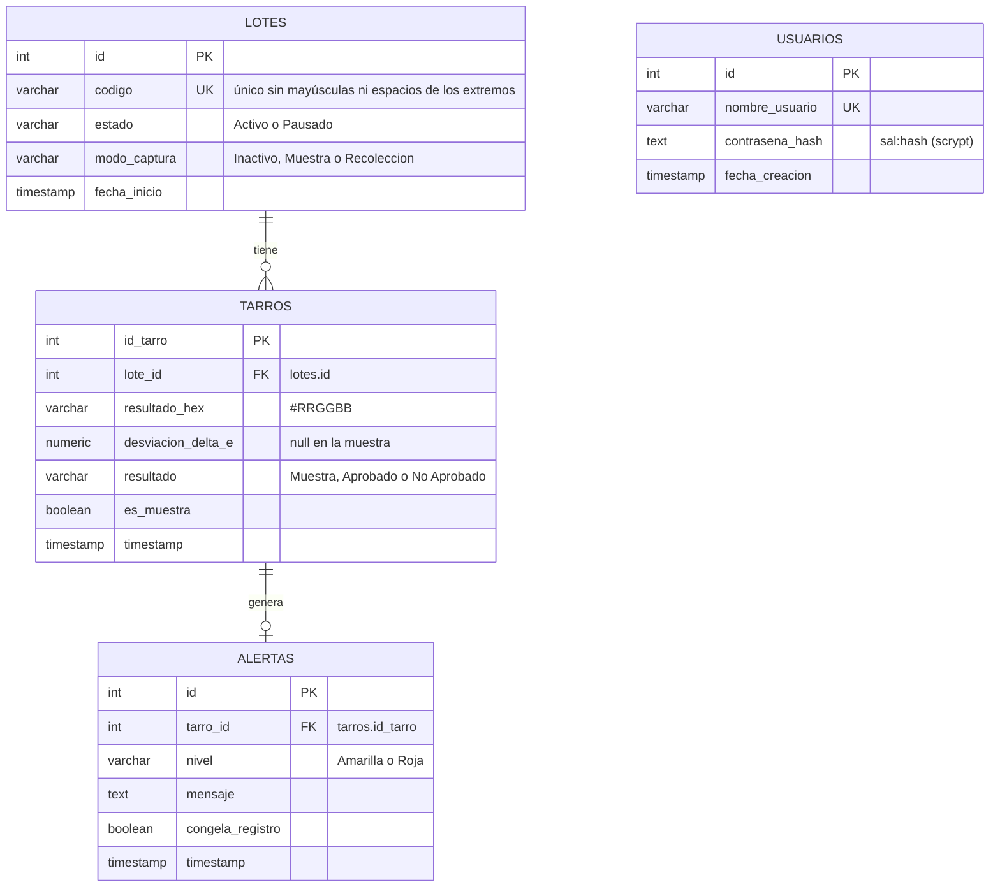

# Modelo de datos · ChromaCheck

Base: PostgreSQL 17 en Neon. Solo el servidor (Next.js) se conecta, con `DATABASE_URL`; el navegador y el puente serial nunca tocan la base directamente, siempre pasan por la API ([contratos/api.md](../contratos/api.md)).

Este documento es la fuente de verdad de las tablas. Antes de crear una tabla, una columna o una consulta nueva, se revisa aquí; si algo cambia, se actualiza este archivo en el mismo PR.

## Diagrama entidad-relación



- Un lote tiene muchos tarros; uno de ellos es la muestra patrón (`es_muestra = true`) y los demás son lecturas.
- Cada lectura genera como máximo una alerta.
- `usuarios` no se relaciona con las demás tablas: hay una sola cuenta del taller y sin roles, así que no se guarda quién creó cada lote o tarro (ver [producto.md](../producto.md)).
- Las franjas de tiempo, los dictámenes posibles y los umbrales de ΔE no son tablas: viven en `lib/modulos/tarros/reglas.ts`.

## Tablas

Los tipos marcados con ¹ se dedujeron del código y del `README.md`; se confirman con las consultas del [anexo](#anexo-consultas-para-confirmar-el-esquema) y, si difieren, se corrige esta tabla.

### `lotes`

| Campo          | Tipo          | ¿Nulo? | Regla                                                                                                                               |
| -------------- | ------------- | ------ | ----------------------------------------------------------------------------------------------------------------------------------- |
| `id`           | `serial` ¹    | No     | Clave primaria                                                                                                                      |
| `codigo`       | `varchar(50)` | No     | De 1 a 50 caracteres sin los espacios de los extremos. Único sin distinguir mayúsculas (índice `lotes_codigo_unico`)                |
| `estado`       | `varchar` ¹   | No     | `Activo` por defecto; `Pausado` tras una alerta roja                                                                                |
| `modo_captura` | `varchar(20)` | No     | `Inactivo` por defecto, `Muestra` o `Recoleccion` (CHECK `lotes_modo_captura_valido`). Solo un lote distinto de `Inactivo` a la vez |
| `fecha_inicio` | `timestamp` ¹ | No     | Fecha de creación del lote (cumple el papel de `created_at`); ordena la lista de lotes                                              |

### `tarros`

| Campo                | Tipo          | ¿Nulo? | Regla                                                                                     |
| -------------------- | ------------- | ------ | ----------------------------------------------------------------------------------------- |
| `id_tarro`           | `serial` ¹    | No     | Clave primaria                                                                            |
| `lote_id`            | `integer`     | No ¹   | Clave foránea a `lotes.id`                                                                |
| `resultado_hex`      | `varchar` ¹   | No     | Color leído con formato `#RRGGBB` (lo valida el servidor)                                 |
| `desviacion_delta_e` | `numeric` ¹   | Sí     | ΔE (CIE76) frente a la muestra, redondeado a 2 decimales. `null` solo en la muestra       |
| `resultado`          | `varchar` ¹   | No     | `Muestra`, `Aprobado` o `No Aprobado`; lo decide el servidor, nunca la petición           |
| `es_muestra`         | `boolean`     | No ¹   | `true` solo en el tarro muestra del lote                                                  |
| `timestamp`          | `timestamp` ¹ | No     | Fecha y hora de la lectura (cumple el papel de `created_at`); ordena lecturas e historial |

### `alertas`

| Campo              | Tipo          | ¿Nulo? | Regla                                                                                 |
| ------------------ | ------------- | ------ | ------------------------------------------------------------------------------------- |
| `id`               | `serial` ¹    | No     | Clave primaria                                                                        |
| `tarro_id`         | `integer`     | No ¹   | Clave foránea a `tarros.id_tarro`: la lectura que causó la alerta                     |
| `nivel`            | `varchar` ¹   | No     | `Amarilla` o `Roja`                                                                   |
| `mensaje`          | `text` ¹      | No     | Motivo que ve el operario (tabla de mensajes de [F5](../specs/F5-alertas-y-pausa.md)) |
| `congela_registro` | `boolean`     | No ¹   | `true` si la alerta pausó el lote; hoy siempre coincide con `nivel = 'Roja'`          |
| `timestamp`        | `timestamp` ¹ | No     | Fecha y hora de la alerta (cumple el papel de `created_at`)                           |

### `usuarios`

Definición confirmada en [contratos/autenticacion.md](../contratos/autenticacion.md).

| Campo             | Tipo          | ¿Nulo? | Regla                                                   |
| ----------------- | ------------- | ------ | ------------------------------------------------------- |
| `id`              | `serial`      | No     | Clave primaria                                          |
| `nombre_usuario`  | `varchar(50)` | No     | Único                                                   |
| `contrasena_hash` | `text`        | No     | `sal:hash` en hexadecimal (scrypt); nunca la contraseña |
| `fecha_creacion`  | `timestamp`   | No     | `now()` por defecto (cumple el papel de `created_at`)   |

## Restricciones

| Nombre                      | Tabla      | Tipo            | Qué garantiza                                                                         |
| --------------------------- | ---------- | --------------- | ------------------------------------------------------------------------------------- |
| Clave primaria              | Todas      | PRIMARY KEY     | Cada fila tiene un id único                                                           |
| `tarros.lote_id`            | `tarros`   | FOREIGN KEY ¹   | No hay tarros de un lote que no existe                                                |
| `alertas.tarro_id`          | `alertas`  | FOREIGN KEY ¹   | No hay alertas de un tarro que no existe                                              |
| `lotes_codigo_unico`        | `lotes`    | UNIQUE (índice) | No hay dos lotes con el mismo código; compara `LOWER(TRIM(codigo))`                   |
| `lotes_un_lote_capturando`  | `lotes`    | UNIQUE parcial  | Solo un lote con `modo_captura <> 'Inactivo'`, aunque lleguen dos peticiones a la vez |
| `lotes_modo_captura_valido` | `lotes`    | CHECK           | `modo_captura` solo puede ser `Inactivo`, `Muestra` o `Recoleccion`                   |
| `usuarios.nombre_usuario`   | `usuarios` | UNIQUE          | No hay dos usuarios con el mismo nombre                                               |

## Reglas de negocio y en qué capa se garantizan

Regla de oro: si una regla protege la integridad del lote o del dictamen, se garantiza en la base; el servidor la repite para responder con un mensaje claro.

| #   | Regla (lo que nunca puede pasar)                                                          | Capa          | Cómo                                                                                                                                                                                         |
| --- | ----------------------------------------------------------------------------------------- | ------------- | -------------------------------------------------------------------------------------------------------------------------------------------------------------------------------------------- |
| R1  | Dos lotes con el mismo código                                                             | BD + servidor | Índice `lotes_codigo_unico`; `insertarLote` traduce el error 23505 y la ruta responde 409                                                                                                    |
| R2  | Un código vacío o de más de 50 caracteres                                                 | Servidor + BD | `POST /api/lotes` recorta espacios y usa `excedeLongitudCodigoLote` (400); la columna es `varchar(50)`                                                                                       |
| R3  | Dos lotes usando el sensor al mismo tiempo                                                | BD + servidor | Índice `lotes_un_lote_capturando`; `cambiarModoCaptura` revisa antes y el repositorio traduce el 23505 a 409 si dos peticiones llegan juntas                                                 |
| R4  | Un modo de captura inventado                                                              | BD + servidor | CHECK `lotes_modo_captura_valido`; la ruta usa `esModoCapturaValido` (400)                                                                                                                   |
| R5  | Dos muestras patrón en un lote                                                            | Servidor      | `obtenerMotivoRechazoMuestra` (409) y `registrarMuestraDeLote`, que en una transacción saca el lote de `Muestra` con un `UPDATE` condicional que bloquea la fila. Falta en la BD (brecha B1) |
| R6  | Registrar la muestra fuera del modo `Muestra`, o una lectura fuera del modo `Recoleccion` | Servidor      | `puedeRegistrarMuestra` y `puedeRegistrarLectura` en `lotes/reglas.ts` (409)                                                                                                                 |
| R7  | Una lectura en un lote sin muestra o `Pausado`                                            | Servidor      | `obtenerMotivoRechazoLectura` en `tarros/reglas.ts` (409)                                                                                                                                    |
| R8  | Un lote pausado que sigue capturando                                                      | BD            | `pausarLoteYDetenerCaptura`: `estado = 'Pausado'` y `modo_captura = 'Inactivo'` en la misma sentencia                                                                                        |
| R9  | Reanudar un lote que no está pausado                                                      | Servidor + BD | `obtenerMotivoRechazoReanudar` (409) y el `UPDATE … WHERE estado = 'Pausado'` de `reanudarLotePausado`                                                                                       |
| R10 | Un ΔE o un dictamen enviados por el cliente                                               | Servidor      | `POST /api/tarros` no lee ΔE ni resultado: los calculan `calcularDesviacionDeltaE` y `obtenerResultadoLectura`                                                                               |
| R11 | Una lectura cuyo `rgb` no es el mismo color que `resultadoHex`                            | Servidor      | `coincidenColorHexYRgb` (400)                                                                                                                                                                |
| R12 | Una lectura fuera de tolerancia sin alerta (ACQ-04)                                       | Servidor      | `registrarAlertaSiCorresponde`: toda lectura con ΔE mayor que la tolerancia registra una alerta amarilla o roja                                                                              |
| R13 | Una contraseña guardada en texto plano                                                    | Servidor      | `hashearContrasena` (scrypt con sal aleatoria); la base solo recibe el hash                                                                                                                  |
| R14 | Crear lotes, cambiar el modo de captura o reanudar sin sesión                             | Servidor      | `proxy.ts` y además `obtenerIdUsuarioDePeticion` en cada una de esas rutas (401)                                                                                                             |
| R15 | Que alguien sin sesión ni clave use la API                                                | Servidor      | `proxy.ts` con `esPeticionDeDispositivo`, que falla cerrada si `CLAVE_DISPOSITIVO` falta o es corta (401)                                                                                    |
| R16 | Una consulta armada pegando texto del usuario (inyección SQL)                             | Servidor      | Los repositorios solo usan consultas parametrizadas (`$1`, `$2`, …)                                                                                                                          |

## Dueño de cada fila

ChromaCheck no tiene filas por persona: hay una sola cuenta del taller y sin roles. Por eso el dueño es **el taller**, y lo que cambia es quién puede crear o modificar cada tabla.

| Tabla      | Dueño        | Crea                                                                          | Modifica                                                                                 | Borra |
| ---------- | ------------ | ----------------------------------------------------------------------------- | ---------------------------------------------------------------------------------------- | ----- |
| `usuarios` | Cada usuario | El equipo, por terminal (`scripts/crear-usuario.ts`); no hay API              | Nadie                                                                                    | Nadie |
| `lotes`    | El taller    | El operario con sesión (`POST /api/lotes`)                                    | El operario con sesión (modo de captura, reanudar) y el servidor (pausa por alerta roja) | Nadie |
| `tarros`   | El taller    | El puente serial con su clave, o una petición con sesión (`POST /api/tarros`) | Nadie: una lectura no se corrige                                                         | Nadie |
| `alertas`  | El taller    | Solo el servidor, como efecto de una lectura                                  | Nadie                                                                                    | Nadie |

No se usa RLS (las reglas por fila de Postgres) porque la base no se expone: solo el servidor la consulta, con una única credencial guardada en `.env.local` y en Vercel. El control de acceso vive en `proxy.ts` y en cada ruta (ver [decisiones.md](../decisiones.md)). Si el sistema pasa a varias empresas o sedes (escenario de [arquitectura.md](../arquitectura.md)), cada tabla tendrá un `empresa_id` y entonces cada consulta deberá filtrar por él, o se activará RLS.

## Checklist del interventor

| Revisión                                                  | Resultado | Nota                                                                                                                                               |
| --------------------------------------------------------- | --------- | -------------------------------------------------------------------------------------------------------------------------------------------------- |
| Cada entidad tiene `id` y `created_at`                    | Cumple    | Con otros nombres: `fecha_inicio`, `timestamp`, `fecha_creacion`; `tarros` usa `id_tarro`. No se renombran: romperían el código y los datos reales |
| Toda relación tiene clave foránea                         | Confirmar | `tarros.lote_id` y `alertas.tarro_id`; confirmar con el anexo que son FOREIGN KEY reales                                                           |
| Toda regla "no puede haber dos…" tiene un UNIQUE          | Parcial   | Código de lote, lote capturando y nombre de usuario sí; una muestra por lote y una alerta por tarro no (B1, B2)                                    |
| Tipos con sentido (fechas como fecha, dinero como entero) | Parcial   | No se maneja dinero. Las fechas son `timestamp` sin zona horaria (B4)                                                                              |
| No hay campos que ninguna spec use                        | Parcial   | `alertas.congela_registro` se escribe pero nadie lo lee (B5)                                                                                       |
| Cada tabla dice quién es el dueño de la fila              | Cumple    | Sección "Dueño de cada fila"                                                                                                                       |

## Brechas

Encontradas al pasar el checklist y al comparar los documentos con el código. B7 es la de mayor riesgo para las entregas: mientras no se corrija, los criterios de F4 y F5 que dependen del umbral fallan. No se corrigen en este PR (es solo documentación); quedan como tareas en [tareas.md](../tareas.md#9-backend-especificación-u4).

| #   | Brecha                                                                                                                                                                                            | Riesgo | Propuesta                                                                                                                                                       |
| --- | ------------------------------------------------------------------------------------------------------------------------------------------------------------------------------------------------- | ------ | --------------------------------------------------------------------------------------------------------------------------------------------------------------- |
| B1  | "Una sola muestra por lote" solo la garantiza el servidor                                                                                                                                         | Medio  | Índice único parcial `tarros_una_muestra_por_lote` sobre `lote_id` donde `es_muestra` es verdadero                                                              |
| B2  | "Cada lectura genera como máximo una alerta" ([arquitectura.md](../arquitectura.md#datos)) no tiene UNIQUE                                                                                        | Bajo   | Confirmar con el anexo; si no existe, índice único sobre `alertas.tarro_id`                                                                                     |
| B3  | No está confirmado que `lotes.estado`, `tarros.resultado` y `alertas.nivel` tengan CHECK                                                                                                          | Bajo   | Confirmar con el anexo; si no existen, CHECK con los valores de las tablas de arriba                                                                            |
| B4  | Las fechas son `timestamp` sin zona horaria; Neon trabaja en UTC y el taller en UTC−5                                                                                                             | Bajo   | Pasar a `timestamptz` en una migración, sin cambiar los datos                                                                                                   |
| B5  | `alertas.congela_registro` repite lo que dice `nivel` y ninguna pantalla lo lee                                                                                                                   | Bajo   | Mantenerlo y agregar un CHECK de coherencia (`congela_registro` verdadero solo si `nivel = 'Roja'`), o quitarlo                                                 |
| B6  | Los cambios de esquema están como SQL suelto en `README.md` y no como migraciones versionadas                                                                                                     | Medio  | Carpeta de migraciones con el esquema actual y un archivo por cambio (bloque Cimientos)                                                                         |
| B7  | Las constantes de `lib/modulos/tarros/reglas.ts` no siguen el umbral de los documentos: `UMBRAL_TOLERANCIA_DELTA_E = 8.0` (documentos: 0,8) y `UMBRAL_ALERTA_ROJA_DELTA_E = 15.0` (documentos: 8) | Alto   | Alinear la constante de `reglas.ts` con el umbral 0,8 (y el límite de roja grave con 8), con sus pruebas; el valor se ajusta al calibrar en el sitio de entrega |

## Anexo: consultas para confirmar el esquema

Son de solo lectura. Se ejecutan en el SQL Editor de Neon y el resultado se usa para quitar las marcas ¹ de este documento.

```sql
-- Columnas, tipos, nulos y valores por defecto
SELECT table_name, column_name, data_type, character_maximum_length, is_nullable, column_default
FROM information_schema.columns
WHERE table_schema = 'public' AND table_name IN ('lotes', 'tarros', 'alertas', 'usuarios')
ORDER BY table_name, ordinal_position;

-- Claves primarias, foráneas, UNIQUE y CHECK
SELECT conrelid::regclass AS tabla, conname AS restriccion, pg_get_constraintdef(oid) AS definicion
FROM pg_constraint
WHERE connamespace = 'public'::regnamespace
ORDER BY 1, 2;

-- Índices (incluidos los únicos parciales)
SELECT tablename, indexname, indexdef
FROM pg_indexes
WHERE schemaname = 'public'
ORDER BY 1, 2;
```
